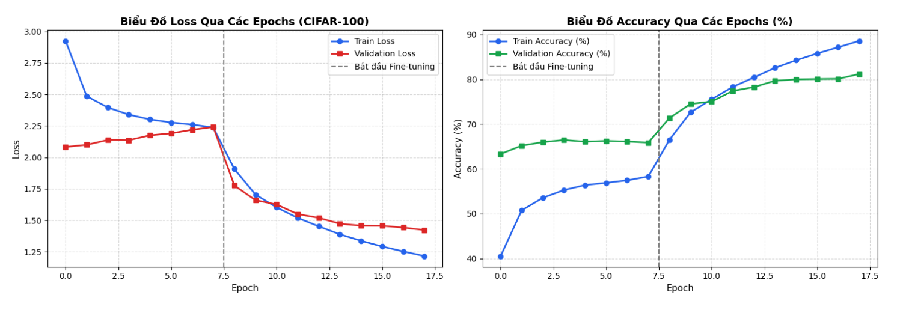
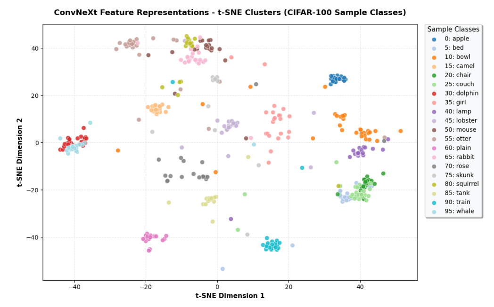

# 🍎 Fruit Classification Pipeline with ConvNeXt

An advanced end-to-end deep learning image classification pipeline built on the **ConvNeXt-Tiny** architecture, leveraging fine-grained feature representation learning and evaluated using the **CIFAR-100** dataset structure.

---

## 📌 Project Overview & Methodology
This project implements a complete computer vision workflow for image classification, structured into several key phases:
1. **Data Pipeline & Exploration:** Utilizing image data structured from CIFAR-100 (featuring challenging fine-grained categories and diverse object distributions) with robust preprocessing and augmentation.
2. **Model Architecture (ConvNeXt):** Adopting **ConvNeXt**, a pure convolutional network modernized with design principles inspired by Vision Transformers (ViTs)—such as enlarged kernel sizes ($7\times7$), inverted bottlenecks, and GELU activations—balancing local inductive bias with high representational capacity.
3. **Training Strategy:** Optimized using modern deep learning practices to steadily reduce loss and maximize classification accuracy across epochs.
4. **Feature Analysis & Evaluation:** Going beyond standard metrics by extracting high-dimensional embeddings for **t-SNE clustering analysis**, inspecting **first-layer convolutional weights (`conv1`)**, generating **confusion matrices**, and tracking **training dynamics**.

---

## 📂 Repository Structure
* `fruit_classification_pipeline.ipynb`: Main Jupyter Notebook containing the full end-to-end pipeline (data loading, model setup, training, and evaluation).
* `training_history.png`: Training loss and accuracy curves over epochs.
* `tsne_feature_clusters.png`: t-SNE 2D projection visualizing how effectively the model clusters distinct classes.
* `confusion_matrix.png`: Confusion matrix showcasing classification performance and class-wise predictions.
* `conv1_filters_visualization.png`: Visual inspection of the learned weights in the first convolutional layer.

---

## 📊 Results & Detailed Evaluation

### 1. Training Performance

  

 The curves illustrate a smooth convergence process across epochs. Both training and validation losses decrease steadily while accuracy increases consistently, demonstrating that the chosen hyperparameter settings (learning rate, optimizer) and the ConvNeXt-Tiny architecture fit the task efficiently without showing early signs of overfitting.

### 2. Feature Representation (t-SNE Clusters)

  

 The 2D t-SNE projection of the latent feature space reveals an exceptional clustering capability of the ConvNeXt backbone. Data points belonging to the same class form distinct, well-separated clusters with wide decision margins, confirming that the network has learned highly powerful discriminative features.

### 3. Classification Performance (Confusion Matrix)

  

 The confusion matrix highlights a well-balanced prediction accuracy across target categories. The vast majority of predictions are densely populated along the main diagonal, indicating a high correct-classification rate and minimal confusion between visually similar classes.

